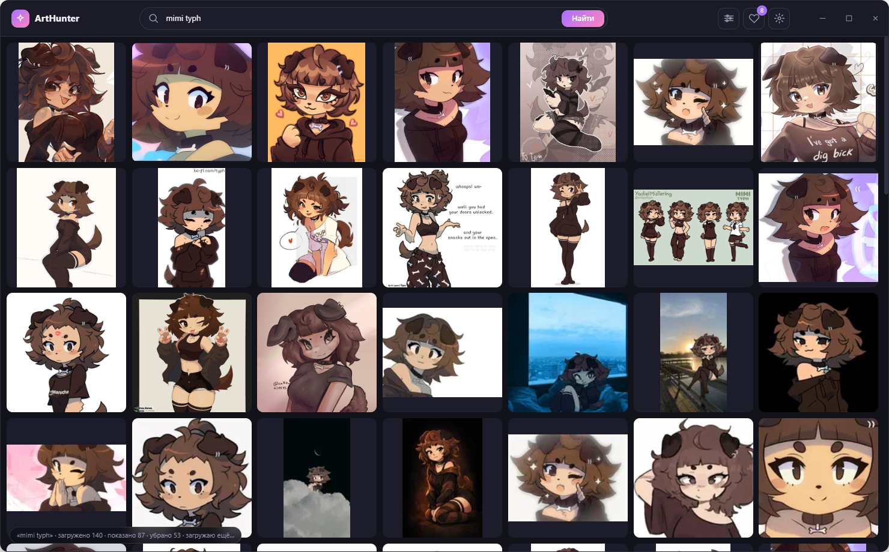
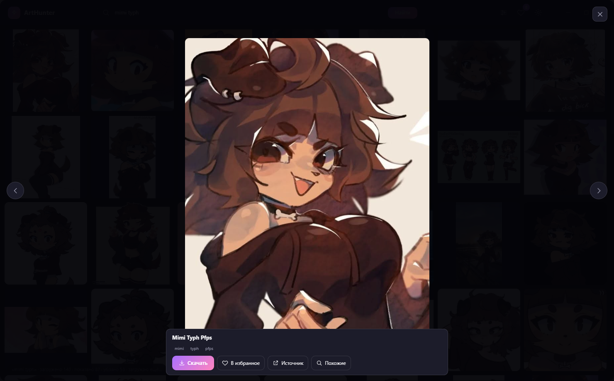
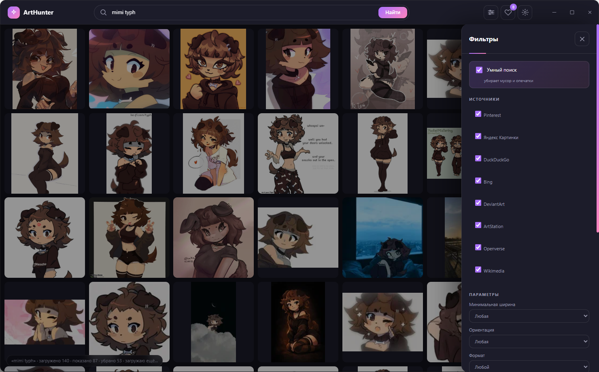
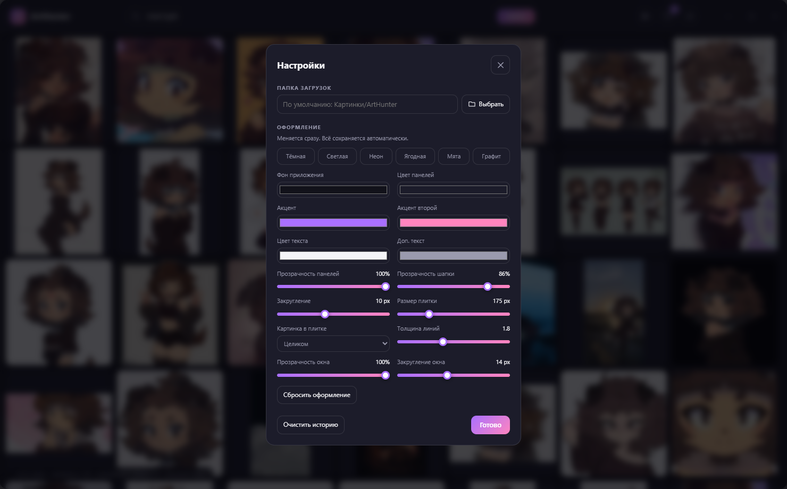
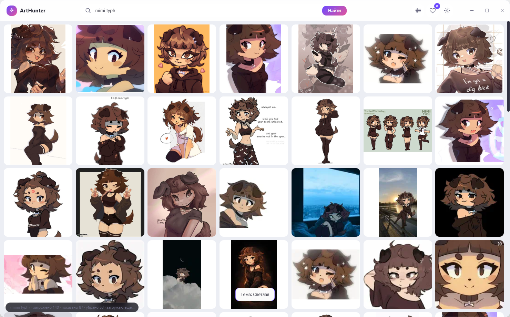

# ✨ ArtHunter

Десктопное приложение для поиска артов и картинок: восемь источников сразу, умная фильтрация мусора, теги, фильтры, избранное и скачивание в один клик. Свой стиль, анимированный интерфейс и настраиваемое оформление.




---

## Что внутри

- **8 источников в одном поиске:** Pinterest, Яндекс Картинки, DuckDuckGo, Bing, DeviantArt, ArtStation, Openverse и Wikimedia Commons. Включаются выборочно.
- **Умный поиск:** синонимы рус→английский, опечатки (`mimy typh` → `mimi typh`), кавычки для фраз, `-слово` для исключения, дедупликация по ссылке и названию.
- **Автоочистка выдачи:** отсекаются видео, соцсети, логотипы, обои, слишком мелкие картинки и результаты без совпадения с запросом. В статусе видно, сколько мусора убрано.
- **Никакого мусора вручную:** кнопка «скрыть» на карточке запоминает картинку, а «Вернуть скрытое» — отменяет.
- **Фильтры и теги:** источники, минимальная ширина, ориентация, формат, сортировка, облако тегов с частотами.
- **Избранное** сохраняется между запусками. Полноэкранный просмотр со стрелками ← → и кнопкой «Похожие».
- **Скачивание в один клик** в настроенную папку (по умолчанию `Картинки/ArtHunter`).
- **6 готовых тем** и 14 ручных настроек: цвета, прозрачность панелей и всего окна, скругление окна и плиток, размер плитки, толщина линий.
- **Бесконечная подгрузка** при скролле и анимации интерфейса.

## Скриншоты

**Поиск и ровная сетка**


**Просмотр картинки**



**Источники, умный поиск и фильтры**



**Настройки и оформление**



**Светлая тема**



## Установка

Скачай установщик из [последнего релиза](https://github.com/Nucoka/art-hunter/releases/latest) и запусти `ArtHunter-Setup-1.0.0.exe`.

Из исходников:

```powershell
git clone https://github.com/Nucoka/art-hunter.git
cd art-hunter
npm install
npm start
```

Если бинарник Electron не скачался автоматически:

```powershell
node node_modules/electron/install.js
```

Сборка установщика: `npm run dist:win` → `dist/ArtHunter-Setup-1.0.0.exe`.

## Быстрый старт

1. Введи запрос в верхней строке и нажми Enter.
2. Листай вниз — картинки подгружаются автоматически.
3. Наведи на карточку: скачать, в избранное, открыть источник или скрыть.
4. Клик по картинке — полноэкранный просмотр, стрелки листают, «Похожие» запускает поиск по названию.
5. Кнопка «фильтры» справа вверху открывает источники, теги и параметры.

### Синтаксис запроса

| Пример | Что делает |
|---|---|
| `mimi typh` | поиск по обоим словам |
| `"mimi typh" furry` | точная фраза + дополнительное слово |
| `кошка арт -gif` | синонимы `cat artwork`, исключить GIF |
| `mimy typh` | опечатка — находится через нечёткое совпадение |

## Источники

| Источник | Комментарий |
|---|---|
| Pinterest | публичный веб-индекс, поиск по `site:pinterest.com` |
| Яндекс Картинки | основной «везде»-поиск, в том числе DeviantArt и ArtStation |
| DuckDuckGo / Bing | классический веб-поиск картинок |
| DeviantArt / ArtStation | через Яндекс с `site:` |
| Openverse / Wikimedia | свободно лицензированные изображения |

Если источник недоступен, остальные продолжают работать.

## Оформление

Готовые темы: **Тёмная**, **Светлая**, **Неон**, **Ягодная**, **Мята**, **Графит**.

Ручные настройки: фон, цвет панелей, цвет текста, дополнительный текст, два акцента, прозрачность панелей / шапки / всего окна, закругление панелей и окна, размер плитки, толщина линий, режим показа картинки (`целиком` / `заполнить`). Всё применяется сразу и сохраняется в `localStorage`; кнопка «Сбросить оформление» возвращает дефолт.

## Разработка

```powershell
npm test                 # 6 тестов: поиск, фильтры, дедупликация, нечёткость
npm run dist:win         # сборка установщика
```

Структура: `main.js` (Electron-процесс и загрузки), `preload.js` (IPC), `providers.js` (источники), `search-utils.js` (поиск и фильтры), `renderer.js` (UI), `styles.css` (стили и темы).

## Релизы

Тег вида `v*` запускает [GitHub Actions](.github/workflows/release.yml): прогоняет тесты, собирает `.exe` и прикрепляет его к релизу. Готовые сборки — на странице [Releases](https://github.com/Nucoka/art-hunter/releases).

## Лицензия

[MIT](LICENSE)
